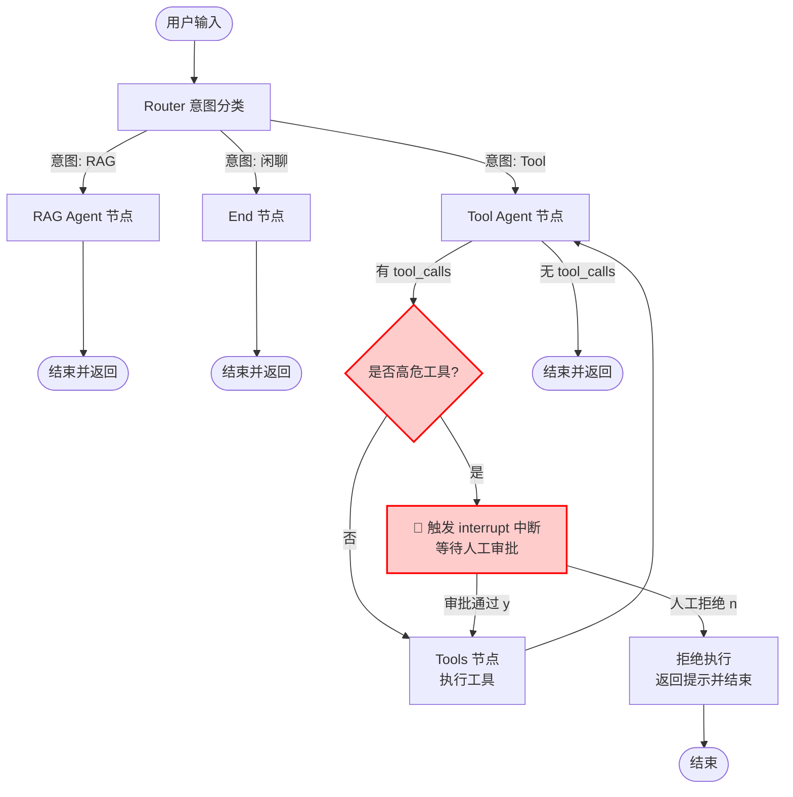

# 🤖 多 Agent 智能客服系统 (Multi-Agent Customer Service)


基于 **LangGraph + LangChain + Chroma** 构建的企业级多 Agent 智能客服系统。本项目实现了从“意图路由”到“RAG 检索”，再到“高危操作人工审批（HITL）”的完整业务闭环，并配有 Streamlit 交互界面。

## 📖 目录

- [核心特性](#-核心特性)
- [架构设计](#-架构设计)
- [技术栈](#-技术栈)
- [快速开始](#-快速开始)
- [核心痛点与解决方案](#-核心痛点与解决方案)
- [项目演进路线-roadmap](#-项目演进路线-roadmap)

---

## ✨ 核心特性

- **🧠 多 Agent 路由分发 (Router)**：系统入口设有 Router 节点，自动分析用户意图，将请求精准分发给 RAG 专家（查内部制度）或 Tool 专家（查天气/算数/退款）。
- **📚 企业级 RAG 检索**：内置混合检索（向量 + BM25）与 Cross-Encoder 重排机制，确保知识库问答的准确性，回答自动附带引用来源。
- **🛠️ Function Calling 工具调用**：支持大模型原生工具调用，处理数学计算与外部 API 请求。
- **🛑 Human-in-the-loop (HITL) 安全审批**：针对“退款”等具有副作用的敏感工具，利用 LangGraph 的 `interrupt()` 实现动态中断。前端挂起等待人工审批，通过后继续执行，拒绝则阻断，确保生产安全。
- **💾 状态持久化**：基于 LangGraph Checkpointer 机制，支持多轮对话上下文记忆与断点恢复。

---

## 🏗️ 架构设计

系统采用 **Supervisor (路由分发)** 架构模式，流程如下：



---

## 🛠️ 技术栈

- **核心框架**：LangGraph (状态机编排)、LangChain
- **大语言模型**：DeepSeek (deepseek-flash)
- **向量化与检索**：Chroma (向量库)、DashScope Embedding (百炼)、BM25Retriever、Cross-Encoder 重排 (BGE-Reranker)
- **前端交互**：Streamlit
- **环境管理**：Python-dotenv

---

## 🚀 快速开始

### 1. 克隆仓库与安装依赖

```bash
git clone https://github.com/your_username/multi-agent-customer-service.git
cd multi-agent-customer-service
pip install -r requirements.txt
```

### 2. 配置环境变量

在根目录创建 `.env` 文件，填入你的 API Key：

```env
DEEPSEEK_API_KEY=your_deepseek_api_key
DASHSCOPE_API_KEY=your_dashscope_api_key
```

### 3. 准备知识库

在根目录创建 `corpus` 文件夹，放入你的 `.md` 或 `.pdf` 格式的企业内部文档（如员工手册、报销制度）。首次运行系统会自动进行文档切分与向量化建库。

### 4. 启动前端界面

```bash
streamlit run app.py
```

打开浏览器访问 `http://localhost:8501` 即可进行交互。

---

## 💡 核心痛点与解决方案 (工程实践)

在开发过程中，我重点解决以下几个 Agent 落地时的实际问题：

### 1. 工具死循环调用问题

- **痛点**：在 LangGraph 的 ReAct 循环中，大模型执行完工具后，再次进入 Tool Agent 节点时，可能会因为上下文理解偏差，重复调用同一个工具，导致死循环。
- **方案**：在 `tool_agent_node` 入口处增加 `isinstance(last_message, ToolMessage)` 的状态拦截。一旦检测到最后一条消息是工具结果，强制让大模型进入最终总结分支，不再绑定 Tools，彻底杜绝死循环。


### 2. 高危操作的合规安全 (HITL)

- **痛点**：Agent 自动生成的参数（如退款金额、订单号）一旦产生幻觉，直接执行会造成企业真实资产损失。
- **方案**：利用 LangGraph 的 `interrupt()` 动态挂起能力，精准拦截 `refund_order` 工具。通过 Streamlit 前端渲染审批卡片，人工确认参数无误后，传入 `Command(resume=True)` 恢复执行，实现了“AI 辅助决策，人类最终拍板”。

---

## 🗺️ 项目演进路线 (Roadmap)

- [x] v0.1：基础 RAG 检索与生成链路。多 Agent 路由与 Function Calling 工具集成。高危操作 HITL 拦截与 Streamlit UI。
- [ ] v0.2：**短期** - 接入 `PostgresSaver` 实现多用户跨进程记忆持久化。
- [ ] v0.3：**中期** - 引入 Query Rewriting (指代消解) 与 LLM-as-Judge (答案幻觉判定)。
- [ ] v0.4：**长期** - 使用 FastAPI + Docker 进行服务化部署，并接入 Langfuse 进行全链路可观测性监控。

---

## 📄 License

MIT License